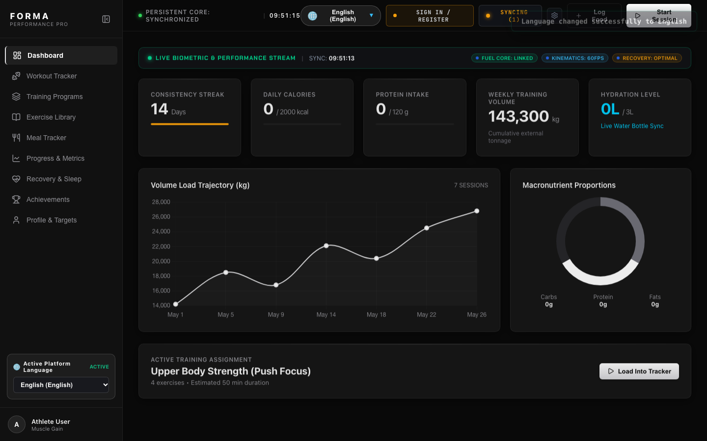
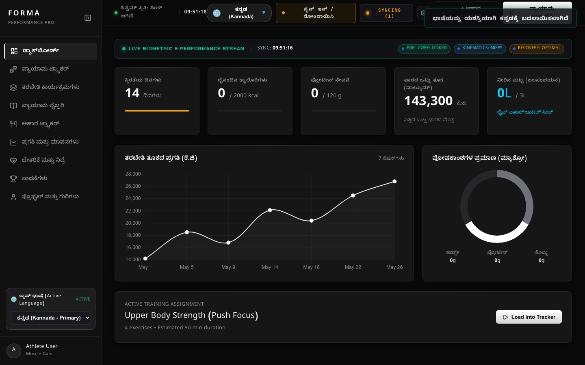
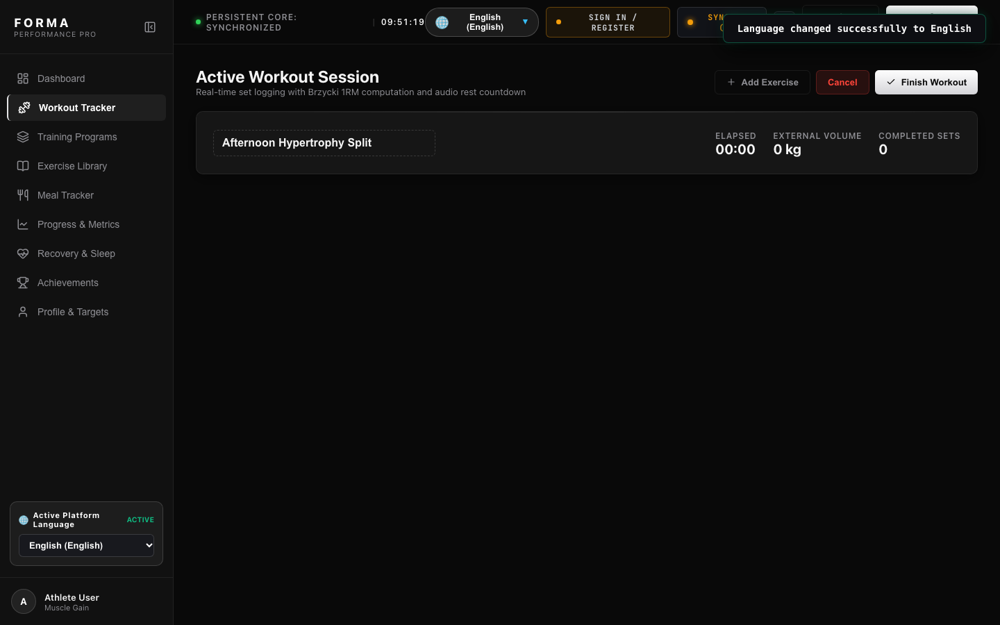
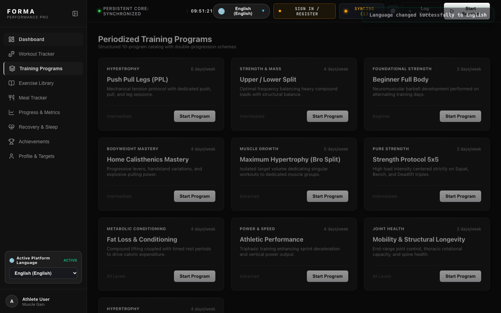
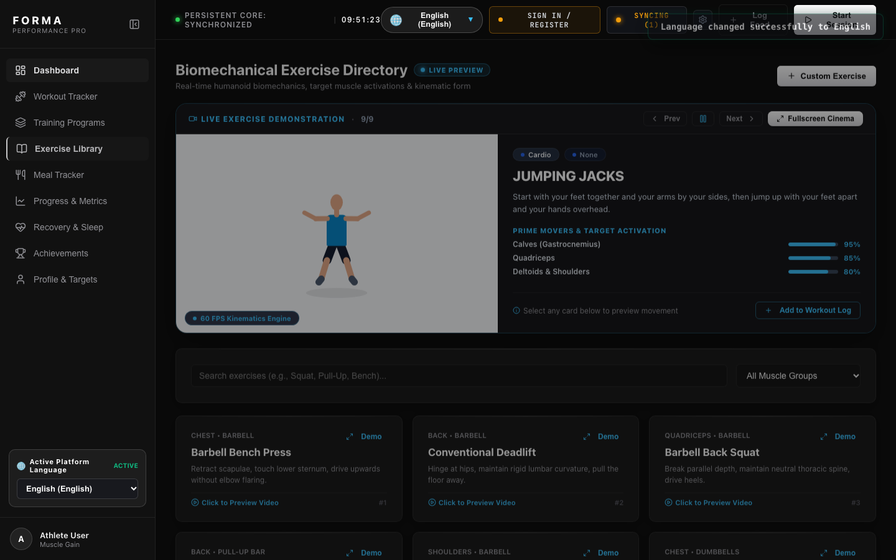
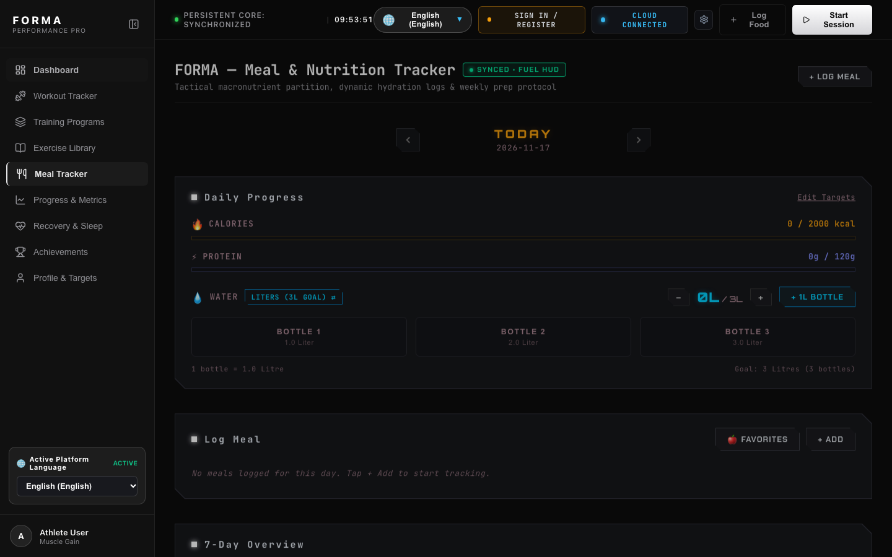
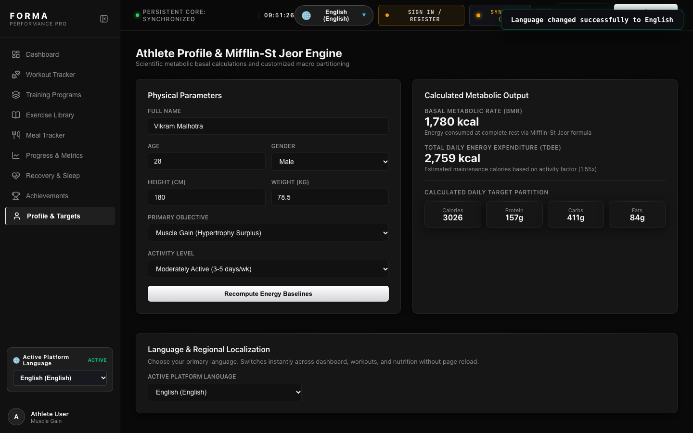

# FORMA — Elite Fitness & Performance Engine
### *Advanced Resistance Tracking, Biomechanical Kinematics & Native Multilingual Regional System*

[](https://github.com/Parthiv307/formelife)
[_Primary-FF7138?style=for-the-badge)](https://github.com/Parthiv307/formelife)
[](https://github.com/Parthiv307/formelife)
[](https://supabase.com)
[](LICENSE)

---

## 🌟 Overview

**FORMA** is an elite sports performance and biometric tracking platform built for athletes, strength trainers, and fitness enthusiasts. Engineered with a focused dark metallic aesthetic, FORMA combines real-time volume load tracking, 60 FPS humanoid biomechanical exercise kinematics, periodized training splits, precision macronutrient and hydration tracking, and a native **Kannada (ಕನ್ನಡ)** multilingual localization system.

Built strictly on modern web standards with an **offline-first modular architecture**, FORMA runs with zero framework overhead, synchronizing seamlessly with a Supabase PostgreSQL backend for encrypted, real-time multi-device continuity.

---

<p align="center">
  
  <br>
  <em>Figure 1: FORMA Executive Dashboard — Live Biometric Stream, Consistency Streaks, Daily Caloric & Protein Progress, Weekly Volume Load Trajectory, and Sidebar Language Switcher.</em>
</p>

---

## 🌐 1. Native Kannada (ಕನ್ನಡ) & Multilingual Regional Localization

FORMA provides a full-featured, zero-latency regional language system with **Kannada (ಕನ್ನಡ)** as its primary regional language, alongside English (default), Hindi (हिन्दी), Tamil (தமிழ்), Telugu (తెలుగు), and Malayalam (മലയാളം).

<p align="center">
  
  <br>
  <em>Figure 2: Complete natural Kannada (ಕನ್ನಡ) localization — ಡ್ಯಾಶ್‌ಬೋರ್ಡ್, ವ್ಯಾಯಾಮ ಟ್ರ್ಯಾಕರ್, ತರಬೇತಿ ತೂಕದ ಪ್ರಗತಿ (ಕೆ.ಜಿ), ಪೋಷಕಾಂಶಗಳ ಪ್ರಮಾಣ, and live telemetry updates.</em>
</p>

### Localization Architecture:
- **Fluent Regional Terminology:** Built using modern, natural Kannada fitness terminology rather than literal machine translation, maintaining clear understanding for exercises, sets, calories, and training metrics.
- **Unmissable Dual-Location Selector:** Change languages instantly at any time via the prominent **Sidebar Language Box** or the **Top Header Quick Pill** without page reloads.
- **Optimized Typography:** Powered by Google's `Noto Sans Kannada` Unicode font with custom line-height and letter-spacing rules (`.lang-kn`) to guarantee proper vowel signs, conjuncts, and zero character overlap.
- **Persistent Cloud & Local Sync:** Selected language persists across browser sessions via `localStorage` and synchronizes to authenticated athlete profiles on Supabase (`profiles.language`).
- **Contextual AI Recommendations:** Features an automated fitness guidance generator producing natural Kannada training tips and nutritional insights (`generateAiRecommendation()`).

#### Terminology Glossary Sample:
| English Concept | Kannada (ಕನ್ನಡ) | Context in FORMA |
| :--- | :--- | :--- |
| **Dashboard** | **ಡ್ಯಾಶ್‌ಬೋರ್ಡ್** | Main biometric and activity hub |
| **Workout Tracker** | **ವ್ಯಾಯಾಮ ಟ್ರ್ಯಾಕರ್** | Active workout and set recording |
| **Training Programs** | **ತರಬೇತಿ ಕಾರ್ಯಕ್ರಮಗಳು** | Double-progression program catalog |
| **Exercise Library** | **ವ್ಯಾಯಾಮ ಲೈಬ್ರರಿ** | Biomechanical kinematic library |
| **Meal Tracker** | **ಆಹಾರ ಟ್ರ್ಯಾಕರ್** | Daily nutritional and hydration log |
| **Consistency Streak** | **ಸ್ಥಿರತೆಯ ದಿನಗಳು** | Consecutive training adherence target |
| **Daily Calories** | **ದೈನಂದಿನ ಕ್ಯಾಲೊರಿಗಳು** | Daily metabolic energy intake |
| **Protein Intake** | **ಪ್ರೋಟೀನ್ ಸೇವನೆ** | Muscle repair and hypertrophy partition |
| **Weekly Volume** | **ವಾರದ ಒಟ್ಟು ತೂಕ (ವಾಲ್ಯೂಮ್)** | Cumulative external tonnage lifted |
| **Hydration Level** | **ನೀರಿನ ಮಟ್ಟ (ಜಲಸಂಚಯನ)** | Real-time water intake vs. 3L goal |
| **Volume Trajectory** | **ತರಬೇತಿ ತೂಕದ ಪ್ರಗತಿ** | Multi-session progressive overload curve |

---

## 🏋️ 2. Active Workout Session & Resistance Tracker

The workout tracking engine is tailored for progressive overload, precise set logging, and neuromuscular recovery timing.

<p align="center">
  
  <br>
  <em>Figure 3: Active Workout Session logger with real-time session timers, external volume calculation, and set completion trackers.</em>
</p>

### Tracking Capabilities:
- **Brzycki One-Rep Max (1RM) Formula:** Evaluates theoretical max strength on every logged set in real-time ($$\text{1RM} = \frac{\text{Weight}}{1.0278 - (0.0278 \times \text{Reps})}$$).
- **Session Telemetry:** Tracks elapsed workout duration, total cumulative session volume (kg), and completed sets count.
- **Rest Interval Countdown:** Visual and audio timer keeps rest periods disciplined between heavy working sets.
- **Persistent Dock:** Floating workout dock allows navigating through other tabs while keeping the active training session accessible.

---

## 📚 3. Periodized Training Programs Catalog

FORMA comes pre-configured with 10 scientific, periodized training programs structured for specific physical adaptations.

<p align="center">
  
  <br>
  <em>Figure 4: Program catalog featuring Push/Pull/Legs, Upper/Lower, Full Body, Calisthenics, Bro Split, and Strength 5x5.</em>
</p>

### Included Training Splits:
1. **Push Pull Legs (PPL):** 6 days/week mechanical tension protocol with dedicated push, pull, and leg sessions.
2. **Upper / Lower Split:** 4 days/week balanced frequency targeting compound lifts and recovery.
3. **Beginner Full Body:** 3 days/week foundational neuromuscular barbell development.
4. **Home Calisthenics Mastery:** 4 days/week progressive bodyweight levers, handstand work, and pulling power.
5. **Maximum Hypertrophy (Bro Split):** 5 days/week isolated target volume dedicated to individual muscle groups.
6. **Strength Protocol 5x5:** 3 days/week high-intensity focus centered on Squat, Bench Press, and Deadlift.
7. **Fat Loss & Conditioning:** 4 days/week compound complexes coupled with timed intervals.
8. **Athletic Performance:** 4 days/week triphasic training enhancing sprint deceleration and vertical power.
9. **Mobility & Structural Longevity:** 3 days/week end-range joint control, thoracic rotation, and spine health.

---

## 🏃 4. Biomechanical Exercise Directory & 60 FPS Kinematics

An interactive anatomy and movement directory that visualizes proper movement pathways and muscle recruitment.

<p align="center">
  
  <br>
  <em>Figure 5: 60 FPS Humanoid kinematic demonstration canvas with prime mover activation meters and step-by-step form guides.</em>
</p>

### Biomechanics Features:
- **60 FPS Canvas Kinematics Engine:** Live humanoid animation demonstrates movement pacing, joint angles, and skeletal alignment.
- **Target Muscle Activation Heatmaps:** Real-time percentage meters indicating primary movers and secondary synergists (e.g., Calves 95%, Quadriceps 85%, Deltoids 80%).
- **Movement Filtering:** Instant filtering across muscle groups (Chest, Back, Quadriceps, Hamstrings, Shoulders, Arms, Core, Cardio).
- **One-Click Session Injection:** Add any library exercise directly into your active workout session with custom set configurations.

---

## 🥗 5. Meal & Nutrition Tracker

A dedicated nutritional module designed for precision energy balance and hydration management.

<p align="center">
  
  <br>
  <em>Figure 6: Daily nutrition tracking HUD with calorie and protein progress bars, 3L water bottle logger, and meal timeline.</em>
</p>

### Nutrition Engine Features:
- **Daily Macronutrient Progress:** Visual progress meters for daily Caloric intake (kcal) and Protein intake (g) against personalized targets.
- **Hydration Monitoring:** Visual water bottle interface tracking 1.0L bottle increments towards the daily 3.0L intracellular target.
- **Weekly Meal Prep System:** Plan and schedule nutrition for every day of the week with instant meal logging.
- **Custom Meal Logging:** Add custom food items, calorie counts, and protein grams with real-time macro balance recalculation.

---

## 👤 6. Athlete Profile & Mifflin-St Jeor Metabolic Engine

The scientific foundation for calculating exact personalized nutritional targets and training volume baselines.

<p align="center">
  
  <br>
  <em>Figure 7: Physical biometric parameters, calculated BMR, TDEE, macronutrient target partitions, and regional language preferences.</em>
</p>

### Scientific Calculations:
- **Basal Metabolic Rate (BMR):** Accurate energy expenditure at rest calculated via the Mifflin-St Jeor formula:
  $$\text{BMR} = 10 \times \text{Weight (kg)} + 6.25 \times \text{Height (cm)} - 5 \times \text{Age (y)} + s$$
  *(where $s = +5$ for males, $-161$ for females).*
- **Total Daily Energy Expenditure (TDEE):** Multiplied by activity factor (Sedentary, Light, Moderate, Very Active) to establish maintenance calories.
- **Target Partitioning:** Computes custom target splits for Calories, Protein, Carbohydrates, and Fats based on the athlete's primary objective (Muscle Gain, Fat Loss, Pure Strength, or Maintenance).

---

## ⚡ 7. Technical Architecture & Data Synchronization

FORMA is engineered as an **offline-first single-page application** with resilient cloud persistence.

```
┌────────────────────────────────────────────────────────┐
│                      FORMA Web App                     │
│  (Desktop Browser, Tablet, or Mobile Viewport)         │
└──────────────────────────┬─────────────────────────────┘
                           │
             ┌─────────────┴─────────────┐
             ▼                           ▼
┌─────────────────────────┐   ┌──────────────────────────┐
│   localStorage Cache    │   │  FormaSyncEngine (Tx)    │
│  • Active Language      │   │  • Offline Tx Queue      │
│  • Workout & Meal State │   │  • Auto Retry Mechanism  │
└─────────────────────────┘   └──────────┬───────────────┘
                                         │
                               (WebSocket Realtime Push)
                                         │
                                         ▼
                     ┌───────────────────────────────────┐
                     │          Supabase Cloud           │
                     │  • PostgreSQL with Row Security   │
                     │  • JWT Athlete Authentication     │
                     │  • Instant Multi-Device Sync      │
                     └───────────────────────────────────┘
```

- **Zero Heavy Frameworks:** Pure Vanilla JavaScript (ES2022+), CSS3 custom properties, and Semantic HTML5 for instantaneous load times (< 100ms) and minimal battery drain.
- **Offline Transaction Queue:** If network drops during training, sets and meal logs queue in memory and automatically flush to Supabase when reconnected.
- **Row-Level Security (RLS):** Supabase PostgreSQL policies strictly isolate athlete data based on `auth.uid()`.

---

## 📁 Source Code Structure

```
forma_platform/
├── css/
│   ├── styles.css           # FORMA core design system & Kannada typography overrides
│   └── hunter-meal.css      # Nutrition HUD layout & bottle hydration styling
├── js/
│   ├── i18n.js              # Kannada (ಕನ್ನಡ) & multilingual translation engine
│   ├── state.js             # Central reactive state store & exercise database
│   ├── main.js              # Application lifecycle, navigation & view controller
│   ├── workout.js           # Workout logging, Brzycki 1RM calculator & audio timers
│   ├── cinema.js            # 60 FPS humanoid biomechanical canvas & exercise library
│   ├── hunter-meal.js       # Daily meal log & water bottle hydration manager
│   ├── charts.js            # Volume load curve & macro doughnut visualizations
│   ├── auth.js              # Supabase authentication & athlete profile manager
│   ├── supabase.js          # Supabase client connector & settings modal
│   └── sync-engine.js       # Real-time WebSocket synchronization & offline queue
├── docs/
│   └── images/              # High-resolution application screenshots
├── html/
│   └── index.html           # Synchronized sub-route mirror
├── index.html               # Main application entry point
├── supabase_schema.sql      # Database schema, table structures, RLS policies & triggers
├── netlify.toml             # Netlify deployment configuration & security headers
└── README.md                # Comprehensive documentation
```

---

## 🚀 Getting Started

### 1. Clone the Repository
```bash
git clone https://github.com/Parthiv307/formelife.git
cd formelife
```

### 2. Run Locally
Because FORMA uses native ES modules, serve it through any static file server:

```bash
# Using Python
python3 -m http.server 8080

# Or using Node
npx serve . -p 8080
```
Open **`http://localhost:8080`** in your browser.

### 3. Connect Supabase (Optional)
1. Set up a free project on [supabase.com](https://supabase.com).
2. Execute the schema script in your Supabase SQL Editor:
   ```bash
   cat supabase_schema.sql
   ```
3. In FORMA, click the **Settings ⚙️** icon in the top header, enter your Supabase URL and Anon Key, and click save. Your workout history, meal logs, and language preferences will now synchronize to your cloud account in real-time.

---

## 📜 License

Distributed under the **MIT License**. See `LICENSE` for details.

---

<p align="center">
  <b>FORMA Performance Pro</b> — Precision Sports Science & Performance Tracking.<br>
  Built with ❤️ for global & regional fitness communities.
</p>
