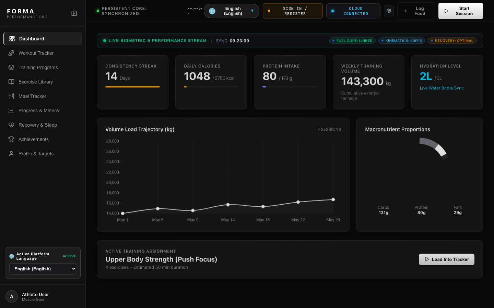
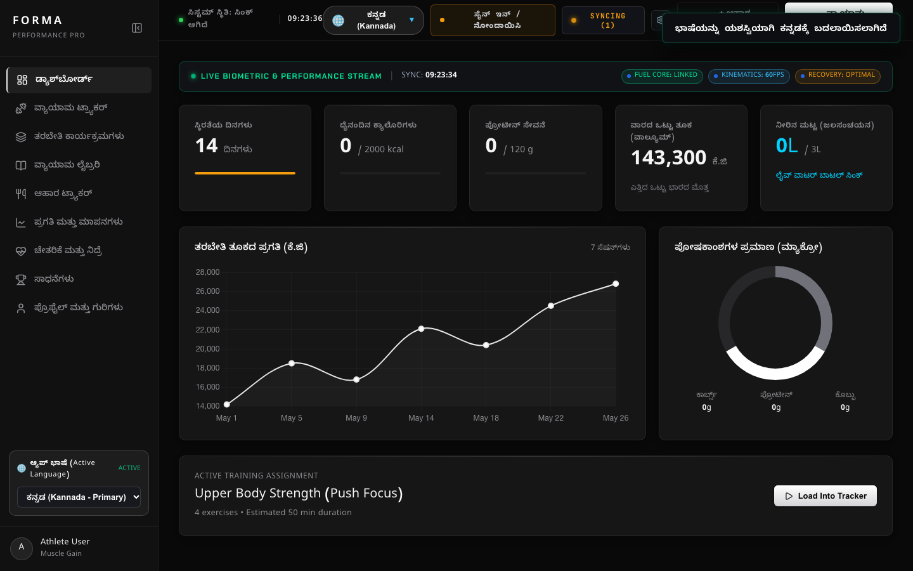
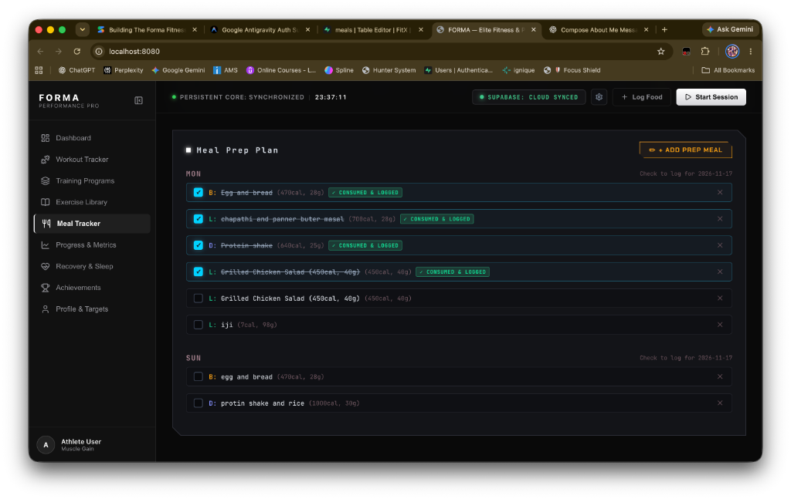
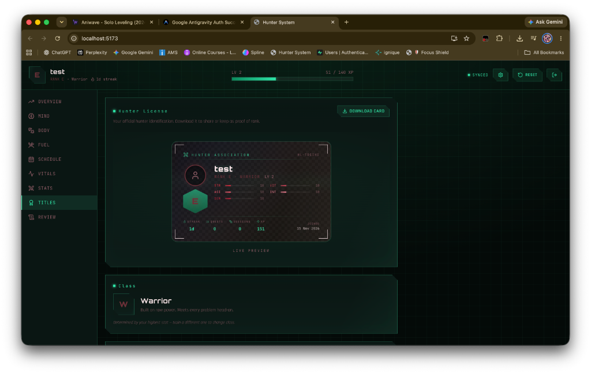
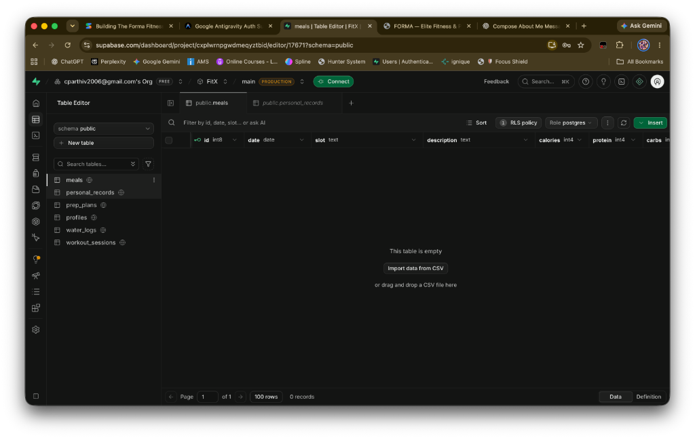

# FORMA — Tactical Fitness Engine & Biometric HUD
### *Advanced Resistance Tracking, Hunter System Fuel HUD & Multilingual Regional Localization*

[](https://supabase.com)
[_Primary-FF7138?style=for-the-badge)](https://github.com/Parthiv307/formelife)
[](https://github.com/Parthiv307/formelife)
[](LICENSE)

---

## 🌟 Executive Overview

**FORMA** is an elite, high-performance fitness platform and tactical biometric HUD designed for serious athletes, bodybuilders, and fitness enthusiasts. Combining a sleek dark tactical aesthetic with cutting-edge resistance tracking, 60 FPS humanoid exercise biomechanics, gamified RPG progression (Hunter System), and a high-fidelity **Kannada (ಕನ್ನಡ)** multilingual translation engine, FORMA delivers an immersive sports science experience across desktop, tablet, and mobile.

Built with an **offline-first modular architecture**, FORMA communicates directly with a **Supabase PostgreSQL** cloud backend via real-time WebSocket subscriptions, ensuring instant cross-device state synchronization with zero server overhead.

---

<p align="center">
  
  <br>
  <em>Figure 1: FORMA Executive Dashboard displaying Live Biometric Streams, Consistency Streaks, KPI Metrics, Volume Trajectory, and the Sidebar Language Switcher.</em>
</p>

---

## 🌐 Feature 1: Kannada (ಕನ್ನಡ) & Multilingual Regional Localization

FORMA features a state-of-the-art multilingual engine with **Kannada (ಕನ್ನಡ)** as its primary regional language, alongside full support for English, Hindi (हिन्दी), Tamil (தமிழ்), Telugu (తెలుగు), and Malayalam (മലയാളം).

<p align="center">
  
  <br>
  <em>Figure 2: FORMA completely localized into fluent, natural Kannada (ಡ್ಯಾಶ್‌ಬೋರ್ಡ್, ವ್ಯಾಯಾಮ ಟ್ರ್ಯಾಕರ್, ತರಬೇತಿ ತೂಕದ ಪ್ರಗತಿ, ಪೋಷಕಾಂಶಗಳ ಪ್ರಮಾಣ, etc.).</em>
</p>

### Key Highlights:
- **Natural, Modern Kannada Terminology:** Avoids rigid literal translations. All exercise names, biomechanical instructions, macronutrient classifications, and metric labels use fluent, context-appropriate Kannada fitness terminology.
- **Instant Live Switching:** Change languages instantaneously from the permanent **Sidebar Language Selector** or the **Top Header Pill** without requiring a page refresh.
- **Typography & Font Optimization:** Integrates Google's `Noto Sans Kannada` Unicode font with optimized line-heights, letter-spacing, and conjunct ligature rendering (`.lang-kn`) to ensure pristine typography across devices.
- **Cross-Device Cloud Sync:** The selected language preference is automatically synchronized to the athlete's cloud profile on Supabase (`profiles.language`) and cached locally in `localStorage`.
- **Translated AI Telemetry Engine:** Generates real-time dietary and training recommendations in natural Kannada (`generateAiRecommendation()`).

#### Terminology Glossary Sample:
| English Concept | Fluent Kannada (ಕನ್ನಡ) | Context & Usage |
| :--- | :--- | :--- |
| **Dashboard** | **ಡ್ಯಾಶ್‌ಬೋರ್ಡ್** | Primary biometric overview |
| **Workout Tracker** | **ವ್ಯಾಯಾಮ ಟ್ರ್ಯಾಕರ್** | Active set & repetition logger |
| **Consistency Streak** | **ಸ್ಥಿರತೆಯ ದಿನಗಳು** | Consecutive training adherence |
| **Daily Calories** | **ದೈನಂದಿನ ಕ್ಯಾಲೊರಿಗಳು** | Active metabolic energy balance |
| **Protein Intake** | **ಪ್ರೋಟೀನ್ ಸೇವನೆ** | Muscular hypertrophy allocation |
| **Weekly Volume** | **ವಾರದ ಒಟ್ಟು ತೂಕ (ವಾಲ್ಯೂಮ್)** | Cumulative external tonnage lifted |
| **Hydration Level** | **ನೀರಿನ ಮಟ್ಟ (ಜಲಸಂಚಯನ)** | Real-time hydration monitoring |
| **Volume Trajectory** | **ತರಬೇತಿ ತೂಕದ ಪ್ರಗತಿ** | Multi-session workload curve |
| **Macronutrients** | **ಪೋಷಕಾಂಶಗಳ ಪ್ರಮಾಣ (ಮ್ಯಾಕ್ರೋ)** | Carbs, protein & fat partition |

---

## ⚔️ Feature 2: Hunter System — Tactical Fuel & Meal Prep HUD

Inspired by gamified RPG rank progression (Solo Leveling), the **Hunter System** provides a tactical HUD for precision nutritional periodization and meal execution.

<p align="center">
  
  <br>
  <em>Figure 3: Hunter System Meal Prep Protocol with day-by-day itemization, macro calculation, and one-tap logging.</em>
</p>

### Capabilities:
- **Weekly Meal Prep Protocol:** Plan nutritional intake across Monday through Sunday with customized slots (Breakfast, Lunch, Dinner, Pre-Workout, Post-Workout).
- **One-Tap Consumption Logging:** Check off prepared meals to log calories, protein, carbs, and fats directly into the daily fuel metrics.
- **Live Water Bottle Sync:** Rapid-log hydration increments (+250ml, +500ml) with visual capacity progress towards the 3.0L intracellular target.
- **Metabolic Baselines:** Integrated Mifflin-St Jeor BMR calculator and TDEE activity factor multipliers for hypertrophy surplus, deficit, or maintenance protocols.

---

## 🎖️ Feature 3: Hunter License, RPG Stats & Rank Cards

<p align="center">
  
  <br>
  <em>Figure 4: Hunter Association Official License with dynamic Rank, Level, XP progression, and physical attributes.</em>
</p>

### Progression Mechanics:
- **Rank Classifications:** Advance from Rank E to National Level Hunter based on consistent workout completions and tonnage PRs.
- **Attribute Allocation:** Monitor Strength (STR), Agility (AGI), Vitality (VIT), and Senses (SEN) calculated from progressive overload history.
- **Exportable Hunter Identification:** Download high-resolution Hunter License ID cards to celebrate milestones.

---

## 🏋️ Feature 4: Resistance Tracker & Biomechanical Library

- **Brzycki One-Rep Max (1RM) Computation:** Real-time formula calculates theoretical maximums on every logged set.
- **Audio Rest Timer:** Automatic auditory and visual cues count down recovery intervals between sets.
- **60 FPS Kinematics Engine:** Interactive exercise demonstration canvas showcasing humanoid skeletal movement, form angles, and primary/secondary muscle activation heatmaps.
- **Double-Progression Programs:** 10 pre-loaded periodized training splits including Push/Pull/Legs, Upper/Lower, 5/3/1 Strength, and German Volume Training.

---

## ☁️ Feature 5: Supabase Cloud & Multi-Device Realtime Engine

FORMA utilizes **Supabase (PostgreSQL + Realtime WebSockets)** for persistent, encrypted, multi-device synchronization.

<p align="center">
  
  <br>
  <em>Figure 5: Supabase Cloud Database schema with Row-Level Security (RLS) and real-time replication channels.</em>
</p>

### Resilient Data Flow:
```
┌─────────────────────────────────┐
│       Athlete Client UI         │
│  (Desktop, Tablet, or Mobile)   │
└───────────────┬─────────────────┘
                │
     ┌──────────┴──────────┐
     ▼                     ▼
┌──────────────┐     ┌──────────────────────┐
│ localStorage │     │ FormaSyncEngine (Tx) │
│ State Cache  │     │ Offline Queue Buffer │
└──────────────┘     └──────────┬───────────┘
                                │
                    (Automatic Flush on Reconnect)
                                │
                                ▼
               ┌─────────────────────────────────┐
               │     Supabase Cloud Services     │
               │  • JWT Athlete Authentication   │
               │  • PostgreSQL with Row Security │
               │  • Realtime WebSocket Channels  │
               └─────────────────────────────────┘
```

- **Row-Level Security (RLS):** Strict security policies ensure athletes access exclusively their own personal records, meals, and workout logs.
- **Offline Transaction Queue:** If internet connectivity drops, workout sets and meal logs queue locally and sync automatically upon reconnection.
- **Cross-Device Broadcasting:** Log a meal on your smartphone; your desktop dashboard updates instantaneously without a refresh.

---

## 📁 Repository Structure

```
forma_platform/
├── css/
│   ├── styles.css           # Luxury metallic dark design system & Kannada typography
│   └── hunter-meal.css      # Hunter System tactical sci-fi meal & HUD styling
├── js/
│   ├── i18n.js              # Kannada (ಕನ್ನಡ) & multilingual localization engine
│   ├── state.js             # Core reactive state store & defaults
│   ├── main.js              # Application controller & view switcher
│   ├── workout.js           # Workout session logger, timers & 1RM calculator
│   ├── cinema.js            # 60 FPS biomechanics exercise library & canvas
│   ├── hunter-meal.js       # Hunter System meal planner & hydration HUD
│   ├── charts.js            # Chart.js volume load curves & macro doughnut
│   ├── auth.js              # Supabase JWT authentication & session handlers
│   ├── supabase.js          # Supabase client manager & configuration
│   └── sync-engine.js       # Real-time WebSocket sync & offline transaction queue
├── docs/
│   └── images/              # High-resolution screenshots for documentation
├── html/
│   └── index.html           # Sub-route HTML mirror (synchronized)
├── index.html               # Main application entry point
├── supabase_schema.sql      # Full PostgreSQL database schema, RLS policies & triggers
├── netlify.toml             # Netlify deployment and security header configuration
└── README.md                # Comprehensive documentation
```

---

## 🚀 Quick Start Guide

### 1. Clone the Repository
```bash
git clone https://github.com/Parthiv307/formelife.git
cd formelife
```

### 2. Launch Local Development Server
Because FORMA uses native ES modules and Web Workers, serve it through any local web server:

**Using Python:**
```bash
python3 -m http.server 8080
```
Then navigate to **`http://localhost:8080`** in your browser.

**Using Node.js:**
```bash
npx serve . -p 8080
```

### 3. Connect Supabase (Optional for Cloud Sync)
1. Create a project at [supabase.com](https://supabase.com).
2. Run the provided SQL migration script in your Supabase SQL Editor:
   ```bash
   cat supabase_schema.sql
   ```
3. Open FORMA in your browser, click the **Settings ⚙️** icon in the top header, and paste your **Supabase Project URL** and **Anon Key**.
4. Register or Sign In with your athlete account. All data will instantly synchronize to your private cloud database.

---

## 🛠️ Technology Stack

- **Frontend Core:** Vanilla JavaScript (ES2022+), Semantic HTML5, Modular CSS3.
- **Typography:** `Noto Sans Kannada`, `Inter`, `Chakra Petch`, `JetBrains Mono`, `Orbitron`.
- **Data Visualization:** Chart.js 4.4, Canvas API, Custom SVG Ring Gauges.
- **Icons:** Lucide Icons.
- **Backend & Cloud:** Supabase (PostgreSQL 15), Supabase Realtime (WebSockets), Supabase GoTrue Auth.
- **Hosting & Edge:** Netlify / GitHub Pages.

---

## 📜 License

Distributed under the **MIT License**. See `LICENSE` for more information.

---

<p align="center">
  <b>FORMA Platform</b> — Designed for Peak Physical Performance.<br>
  Built with ❤️ for the global & Kannada-speaking fitness community.
</p>
